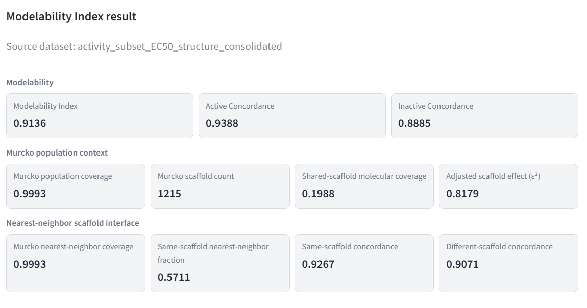

# ChemVault — Traceable Target-Centered Bioactivity Dataset Construction and Modelability Assessment

[](LICENSE)
[]()
[](https://pypi.org/project/chemvault/)
[](https://pypi.org/project/chemvault/)
[](https://github.com/NanoBiostructuresRG-lab/chemvault/actions/workflows/ci.yml)
[](https://nanobiostructuresrg.github.io/chemvault/)


## Description

**ChemVault** is a Python application for constructing and curating molecular datasets from CSV files or target-centered PubChem bioactivity data. It preserves source provenance and processing history and assesses activity-label consistency in molecular fingerprint space for eligible datasets.

It is intended for researchers in chemistry, cheminformatics, chemical biology, and related fields.


## Demo



*Example of a completed MODELABILITY INDEX analysis for a structure-consolidated EC50 dataset. Murcko metrics provide structural context and do not alter the index.*

## Requirements

- Python 3.12 (the supported release environment).
- A Python environment with `pip`. A virtual environment is recommended.

Git and Conda are not required for installation from PyPI. Compatible versions of HARMONSMILE and MOLRAPTOR are installed as package dependencies.

## Installation

Install ChemVault from [PyPI](https://pypi.org/project/ChemVault/):

```bash
python -m pip install chemvault
```

To upgrade an existing installation:

```bash
python -m pip install --upgrade chemvault
```

For installation from source or an editable development environment, see [Contributing](CONTRIBUTING.md).

## Usage

Start the application:

```bash
chemvault
```

The Streamlit interface is normally available at `http://localhost:8501`. Check the installed version with `chemvault --version`.

**CSV datasets:** Create or select a database, upload a CSV file, inspect and refine its data, and export the selected table or columns. Importing a CSV alone does not establish the PubChem provenance required for the target-centered activity-label and modelability workflows.

**Target-centered PubChem datasets:** Select a biological target by gene symbol and organism or by UniProt accession, then run the PubChem search. For eligible structured activity data, harmonize molecular structures with HARMONSMILE, consolidate the preserved PubChem activity labels, and assess the resulting structure-level dataset with the **MODELABILITY INDEX** using MOLRAPTOR fingerprints. Results include nearest-neighbor and Murcko relationships (`.csv`), an analysis report (`.json`), and fingerprint artifacts (`.npz`).

The MODELABILITY INDEX measures nearest-neighbor agreement of the preserved binary labels; it does not train or validate a predictive model. See the [Usage guide](docs/usage.md) for requirements, procedures, eligibility conditions, and interpretation.

## Configuration

| Setting | Default | Purpose |
|---|---|---|
| `CHEMVAULT_API_URL` | Unset | Uses the local application and SQLite backend. When configured, supported operations use the specified FastAPI service. |
| Working directory | Directory from which `chemvault` is launched | User databases are stored in `SQL/<database_id>.db` relative to this directory. |

The optional API-client mode is intended for development and validation. It does not silently fall back to local execution when the configured backend is unavailable. See the [API reference](docs/api.md) for setup and supported operations.

## Documentation

- [Documentation overview](docs/index.md)
- [Usage guide](docs/usage.md)
- [API reference](docs/api.md)

## Citation

Use the metadata in [CITATION.cff](CITATION.cff) to cite ChemVault. Identify the software version used in a scientific analysis.

## Contributing

See [CONTRIBUTING.md](CONTRIBUTING.md) for development setup, tests, and pull-request guidance.

## License

ChemVault is licensed under the [GNU Lesser General Public License v3.0 or later](LICENSE) (`LGPL-3.0-or-later`).
