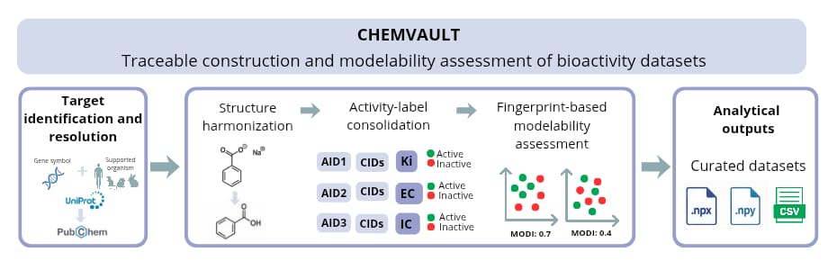

# ChemVault

<section class="cv-hero">
  <div class="cv-hero__content">
    <p class="cv-eyebrow">Bioactivity datasets and modelability</p>
    <div class="cv-brand">
      
      <span class="cv-brand__wordmark">ChemVault</span>
    </div>
    <p class="cv-subtitle">Traceable target-centered bioactivity dataset construction and modelability assessment</p>
    <div class="cv-actions">
      <a class="md-button md-button--primary" href="usage/">Usage</a>
      <a class="md-button" href="api/">API Reference</a>
      <a class="md-button" href="changelog/">Changelog</a>
    </div>
    <div class="ms-badges" aria-label="Project badges">
      <a href="https://github.com/NanoBiostructuresRG-lab/chemvault/blob/main/LICENSE"></a>
      <a href="https://pypi.org/project/chemvault/"></a>
      <a href="https://pypi.org/project/chemvault/"></a>
      <a href="https://github.com/NanoBiostructuresRG-lab/chemvault/actions/workflows/ci.yml"></a>
    </div>
  </div>
</section>

## Scientific purpose

**ChemVault** is a Python application for constructing and curating molecular
datasets and assessing the modelability of eligible bioactivity datasets. It
supports CSV imports and target-centered bioactivity dataset construction from
PubChem.

In the target-centered workflow, a biological target is specified by a UniProt
accession or resolved from a gene symbol and supported organism. ChemVault
retrieves associated compounds, bioassays, and structured activity records and
stores their relationships in SQLite.

Eligible PubChem-derived activity data can undergo molecular structure
harmonization through HARMONSMILE, consolidation of preserved activity outcomes,
and fingerprint-based modelability assessment. Importing a CSV alone does not
establish the PubChem provenance and structure-level consolidation required for
the MODELABILITY INDEX workflow.

!!! note "Scientific boundary"

    **ChemVault** is a dataset construction and assessment application, not a
    predictive-model training system. Molecular fingerprint generation is
    delegated to [MOLRAPTOR](https://pypi.org/project/molraptor/); **ChemVault**
    does not implement fingerprint algorithms.

## Core scientific entities

| Entity | Meaning in **ChemVault** |
|---|---|
| Compound | A source compound identity, normally represented by a PubChem CID. One compound can participate in multiple bioassays. |
| Molecular structure | The chemical representation associated with a compound. `SMILES_Harmonized` is the downstream structure key after harmonization. |
| Activity record | One structured observation for a compound in a bioassay, including its reported outcome and, when available, quantitative type, value, and unit. |
| Bioassay | A PubChem assay identified by an AID. It can contribute activity records for many compounds. |
| Biological target | The protein-centered identity used to construct a PubChem dataset, represented canonically by one UniProt accession and its available target metadata. |

These concepts are deliberately separate. A CID count is not an activity-record
count, an AID is not a compound, and repeated activity observations do not
automatically represent distinct harmonized structures.

Source provenance identifies where the data originated. Processing history
records operations performed within ChemVault. Both support traceability, but
neither establishes the completeness of retrieved source data by itself.

## Traceable workflow

<section class="cv-panel">
  <div class="cv-grid cv-grid--three">
    <article class="cv-card">
      <span class="cv-card__tag">01</span>
      <h3>Construct</h3>
      <p>Import a CSV dataset for inspection and export, or construct a target-centered PubChem dataset using a gene symbol and organism or a UniProt accession.</p>
    </article>
    <article class="cv-card">
      <span class="cv-card__tag">02</span>
      <h3>Curate</h3>
      <p>For eligible PubChem data, select structured activity, harmonize molecular structures, and consolidate preserved activity outcomes by structure.</p>
    </article>
    <article class="cv-card">
      <span class="cv-card__tag">03</span>
      <h3>Assess</h3>
      <p>For eligible consolidated datasets, calculate the MODELABILITY INDEX using MOLRAPTOR fingerprints and inspect Murcko structural context.</p>
    </article>
  </div>
</section>


The following diagram illustrates the target-centered PubChem workflow.
CSV import is a separate entry path and does not, by itself, establish
eligibility for activity-label consolidation or modelability assessment.



*Figure 1. Target-centered bioactivity workflow in ChemVault.*


**ChemVault** retains source tables and records the origins and operations of
derived tables. Persisted jobs expose progress and terminal outcomes. Analysis
exports include identifiers and provenance for their associated populations
and fingerprint representations.

## Documentation

- [Usage](usage.md) covers installation, execution modes, dataset construction,
  scientific workflows, storage, and exports.
- [API Reference](api.md) documents the supported FastAPI endpoints, backend
  gateway, persisted job contracts, and execution distinctions.
- [Changelog](changelog.md) includes the authoritative root changelog without
  duplicating it.

## Citation

```text
Contreras-Torres, F. F., Murrieta, A. C., Castro-Flores, D., Saldívar-González, F. I. (2026). CHEMVAULT — Traceable Target-Centered Bioactivity Dataset Construction and Modelability Assessment. Zenodo. https://doi.org/10.5281/zenodo.23378448
```

Use [CITATION.cff](https://github.com/NanoBiostructuresRG-lab/chemvault/blob/main/CITATION.cff) as the authoritative machine-readable citation metadata for **ChemVault**. Citation metadata is updated with each release.

## License

**ChemVault** is licensed under the
[GNU Lesser General Public License v3.0 or later](https://github.com/NanoBiostructuresRG-lab/chemvault/blob/main/LICENSE).
The SPDX identifier is `LGPL-3.0-or-later`.
